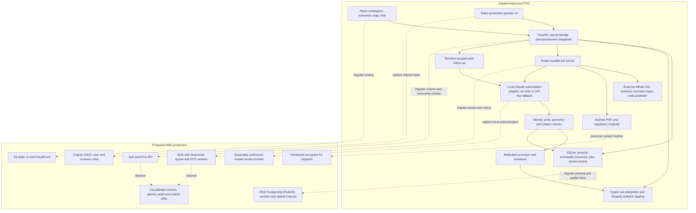

# Architecture and production handoff

The implemented application is a single-user local POC. It has a Python API, React/Leaflet workspace and operator UI, SQLite revisions/jobs/review events, hashed original documents, a bounded worker and a subscription-authenticated model adapter. The diagram labels the proposed AWS replacements separately; no cloud deployment is claimed.

## Ownership and data flow

The browser supplies a server-issued snapshot ID and design choices. It cannot supply trusted zoning, arbitrary source URLs, or approved rules. The API acquires jurisdiction, complete zoning, footprint context and named restrictions from configured sources. The worker discovers documents by assessor/tract identity, retains original bytes, and records model observations with exact page regions. Deterministic validators reject identity, units, arithmetic or geometry conflicts. Machine corroboration remains distinct from legal review.

The interpreter consumes finite expression trees, never generated Python. Source text becomes an untrusted candidate; source-span/dependency checks and attributed review precede activation. An activated expression retains the project's site eligibility gates. Changed source pointers invalidate dependent current rules; saved scenarios retain their original assessment, context and rule versions. A failed source or model produces an explicit failure, without fixture fallback.

The geometry service calculates in EPSG:2229 US survey feet and exports CRS84 coordinates. It applies front/side/rear setbacks separately. Ambiguous frontage, irregular/multipart parcels or missing rules withhold the envelope. An envelope excludes unmodeled easements, fire separation and other restrictions; it is not an entitlement boundary.

## Production migration sequence

1. Add OIDC identity and enforce project ownership on every project/scenario/feedback/question read and mutation; separate source-review and activation roles. Replace the local shared operator token. Keep the API private until ownership tests pass.
2. Migrate SQLite records and immutable IDs to PostgreSQL; use PostGIS for indexed geometry and versioned intersections. Compare replayed assessment hashes before cutover. Preserve historical artifacts and source timestamps.
3. Upload originals to encrypted versioned S3 under content-hash keys. Verify every object checksum and database reference. Keep current-source pointers separate from immutable originals.
4. Move worker jobs to SQS with leases, bounded visibility, cancellation state and a dead-letter queue. Preserve deduplication keys and terminal budgets. Workers must not acknowledge until result commits succeed; duplicate delivery must be idempotent.
5. Select and authorize a hosted model contract independently. A personal Claude subscription is used only by the local workflow; it is not assumed to license a hosted multi-user service. Preserve image/prompt/model versions and validation behavior across adapters.
6. Release static assets through CloudFront and the API behind ALB/ECS. Configure TLS, strict origin policy, request limits and bounded source egress. Source URLs remain allowlisted by adapter.
7. Enable RDS point-in-time recovery, S3 version retention and encrypted backups. Restore a staging copy, verify hashes, replay saved assessments and test interrupted-job recovery before switching traffic.

## Operational ownership and alerts

API owner: context latency/error rate, stale-snapshot errors and p95 recalculation. Worker owner: queue age, stage duration, provider failures/cancellations, document bytes/pages and the240second terminal budget. Regulatory reviewer: source changes, invalidated packages, unresolved references and feedback resolution. Alert on a changed active source, repeated403/429, growing dead-letter queue or missing originals. Do not automatically activate model proposals to clear an alarm.

Each assessment should carry request/scenario ID, source and rule versions, observation provenance and timing. Avoid logging operator credentials, provider authentication or full user project notes. Public maps are evidence; saved design notes may be private. Define retention/deletion with the project owner before production.

## Extending geography

The typed interpreter accepts jurisdiction/regime/project identifiers independently of LA. A synthetic second-jurisdiction test exercises source validation and expression evaluation; activation in this POC deliberately permits only the reviewed LA packages. A new jurisdiction needs its own source adapters, CRS, coverage/dependency review, applicability predicates and positive/negative acceptance corpus. It must never inherit LA rules as a fallback.
