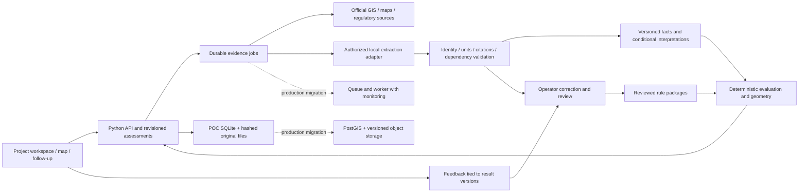

# Full-feature PRD delivery plan

Planning baseline: 2026-10-22. Primary authority: `docs/project_1771987446618.pdf`, all four pages reread. This plan supersedes the old sequential roadmap as the delivery contract. It is a plan, not a claim that these features already exist.

## 1. What we are delivering

An architect enters any LA residential address/APN, selects a project type and supplies actual design choices. The product acquires parcel and regulatory evidence, returns a structured assessment, explains the governing constraints and uncertainty, and updates as the design changes. The architect can inspect source passages/maps, ask grounded follow-up questions, compare scenarios, submit corrections, and see supported setback geometry. An operator can demonstrate and review the ingestion pipeline in the UI.

The same pipeline must run for a never-before-seen property. The Louise records become regression examples, not prerequisites or a lookup table that impersonates automation. No user or developer must add an address to code or hand-author observations before the system attempts the assessment.

All six PRD bonus features are included in this requested full-feature release. The POC remains a bounded regulatory implementation, as the PRD explicitly permits; it is not an exhaustive entitlement, engineering or permit determination. An unsupported jurisdiction or rule branch must still get a useful parcel/evidence report with its specific coverage gap. We must not present a collection of unsupported cards as successful support for a named building type.

## 2. Requirement-to-delivery matrix

Status below comes from code/document inspection, not just previous task counts. IDs are used by OpenSpec tasks and final acceptance.

| ID / PRD location | Requirement | Current state | Delivery and acceptance |
| --- | --- | --- | --- |
| P1, p1 | Answer what can confidently be built; synthesize distributed evidence | Partial: five gated scalar values, no project summary | Summary identifies project classification, resolved constraints, conflicts, design implications and next decisions; links every conclusion to evidence |
| P2, p1 | Refine understanding as project evolves | Partial: transient numeric inputs recompute | Persist versioned scenarios; changes recalculate relevant constraints and geometry, retaining prior versions for comparison |
| P3, p1 | Reasonable interpretations or decision paths for ambiguity | Partial: blockers but no modeled alternatives | Explicit conditional branches with assumptions, evidence and consequences; never substitute an assumed branch for verified applicability |
| M1, p2 | Reduce regulatory research effort to zero | Not met; users must research five broad assertions; two seeded maps | Zero external searching/transcription on the clean supported acceptance cases; measure residual decisions separately. Exceptions identify a specific unresolved source/fact; do not claim universal zero research |
| M2, p2 | Real-time answers as inputs change | Partial: local evaluator fast, acquisition synchronous | UI acknowledges actions immediately; incremental context within 30 s; loaded recomputation p95 <1 s; long evidence jobs show progress and are independently bounded |
| M3, p2 | Consistent cited answers across parcels | Partial: narrow deterministic rules | Same source/fact/project versions give identical answers; no address-dependent rules; cross-parcel boundary and metamorphic tests |
| T1, p2 | Python backend, JS/TS frontend | Met | Keep FastAPI/Python and React/TypeScript; verify build/test/install from clean checkout |
| T2, p2 | AWS preferred; other tools/frameworks discretionary | Architecture only; no production deployment | Actionable AWS-oriented diagram and migration/runbook, clearly distinguishing proposed from implemented. Do not treat suggested PostGIS or cloud hosting as mandatory POC infrastructure |
| S1, p3 | Modern LLM/AI/ML supports underlying solution | Partial: extraction CLI exists, formulas are fed to it | Actual source-driven rule extraction and general map interpretation; record model/prompt/source versions, validation, cost/time, failures and human corrections |
| S2, p3 | LA residential geography and public parcel/zoning/regulatory information | Partial: generic GIS and map download | General search/evidence acquisition including document discovery, lot identity and restrictions; fresh unseen-address tests. Fixtures only in labeled demo/tests, never live fallback |
| S3, p3 | Regulatory ingestion/synthesis is core; text becomes explainable fragments | Partial: exact five formulas and category mapping encoded in prompt/evaluator | Extract operands, predicates, exceptions and dependencies from sources; review and activate versioned structured expressions; source mutation tests prove answers derive from the source |
| S4, p3 | Small well-reasoned rule/agency subset | Met as a scope allowance, not product completion | Publish an explicit coverage matrix for three named project packages and exclusions; no promise of all zones or full building code |
| S5, p3 | Parcel-to-constraints reasoning with citations/confidence | Partial | Evidence graph connects identity → facts → applicable branches → input values → calculation → conclusion; field-specific confidence and reasons |
| S6, p3 | Architecture can extend to other jurisdictions | Partial architecture, hardcoded R1 validation | Jurisdiction/regime/project identifiers in rules and source adapters; second synthetic jurisdiction contract test proves separation, no new live jurisdiction promised |
| S7, p3 | Clarity, traceability, explainability prioritized | Partial | Source viewer, extraction highlights, readable default explanations; sourced/estimated/interpreted/user assumptions visually and textually distinct |
| D1, p3 | One-week POC | Original timebox; completion not demonstrated | Five-day target sequence below; report elapsed effort and gate results honestly. All-feature delivery is at risk; do not silently redefine the week or cut required behavior |
| F1, pp3–4 | Address/APN entry → real-time structured assessment with zoning, citations, provenance, derivation and confidence | Partial | One coherent end-to-end flow on holdout addresses; no per-address preprocessing by a developer |
| F2, p4 | Basic parcel and existing-building visualization | Present | Retain readable geometry, building vintage/availability and map-independent text; test missing tiles/footprints and CRS failures |
| F3, p4 | Range of residential parcels and building types: single-family, ADU, guest house | Incomplete: ADU/guest house always unsupported | Meaningful positive rule-backed results for a named variant of each type, plus exceptions; test all three selections across a frozen cohort |
| F4, p4 | Target users interact and easily see outputs | Partial: dense controls, repeated assertions | Guided project questions, progressive source status, compact summary, accessible drill-down, mobile/keyboard flows; scripted user-like acceptance from a clean session |
| F5, p4 | Simple actionable production architecture diagram | Present but needs full-feature update | Diagram includes UI/API/worker, sources, model boundary, evidence/object store, PostGIS, review, monitoring and restore; migration responsibilities and failure paths documented |
| B1, p4 | Responsive to project inputs and current state | Partial: height/slope only | Parameterized project variants, proposed area/height/roof/use and relevant existing-building facts; compare saved scenarios without stale evidence |
| B2, p4 | User feedback on bad responses | Missing | Submit correction/comment against a specific assessment/constraint/source; durable status and operator review; feedback never auto-edits an active rule |
| B3, p4 | Chat-like follow-up on results/data | Missing | Current-assessment grounded Q&A with clickable citations, explicit no-evidence answers, scenario isolation, request cancellation and recorded evaluation |
| B4, p4 | Interactive regulatory map annotations | Missing beyond parcel/footprints | Select constraint to highlight supporting parcel edge/overlay/annotation and explanation; selection works both map→card and card→map |
| B5, p4 | Actionable geometry such as setbacks | Missing | Source-backed front/side/rear edge classification and setback envelope for supported lot/project conditions, dimensions and exportable GeoJSON; uncertainty prevents misleading geometry |
| B6, p4 | Admin UI demonstrates pipeline and adjustment | Missing; CLI only | Source fetch → candidate extraction → validation → comparison/correction → reviewed activation; show versions, failures, feedback and rollback history |

## 3. Supported regulatory product scope

Build three independently reviewed packages, not one R1 rule reused under different labels:

1. **Single-family main building:** retain the five Chapter 1 R1-1 scalar constraints, source their actual predicates and measurements, add project fit/comparison and supported setback envelope. Split broad checks into source-establishable facts and genuine design/interpretation decisions.
2. **New detached ADU on a residential parcel with an existing primary dwelling:** review current state/local definitions, eligibility, precedence and the relevant dimensional/area/height/setback branches plus applicable exceptions. Do not assert current numerical limits in this plan before official-source research. Attached ADUs, conversions, JADUs and multifamily variants get explicit branch-level exclusions initially.
3. **Detached guest-house proposal:** establish the official use definition and distinguish it from an ADU and other accessory uses. Model the permitted-use/occupancy/cooking limitations and applicable dimensional rules for one documented residential context. Misclassified proposals route to the correct package or an explicit eligibility conflict.

Document lawful applicability and source versions for every chosen branch. R1-1 is a justified starting zone for the main-building package, not a restriction on which properties may be searched. Other zones retain complete designation and retrieved evidence; rules run only if their own reviewed applicability covers that zone. Chapter 1A does not inherit Chapter 1 rules. Construction-code-wide compliance and every special-plan exception remain outside the POC; available building-code evidence is catalogued and clearly separated from planning/zoning conclusions.

The PRD's named resources are inputs, not automatically equivalent authorities: verify municipal zoning sections rather than assuming the supplied “Administrative Code” label is the correct zoning source. Verify which building-code edition is applicable before any building-code claims. Public source freshness and applicability dates must be explicit.

## 4. Delivery workstreams and sequence

### A. Freeze acceptance and prove the riskiest paths first

Create the matrix above as executable release evidence. Freeze at least 12 real parcels spanning at least three map books and different LA neighborhoods, including rectangular, corner/irregular, constrained/overlay, zoning ambiguity and an outside-city control. Reserve six non-Louise parcels as holdouts; they must not appear in authored observation records or extractor examples. Preserve the provided/project-discovered addresses; add public cases where necessary and label their provenance.

Before building more UI, demonstrate the allowed model adapter can process a new map, identify its lot and return grounded structured observations, and can extract a rule from a passage without being supplied the answer. Verify current official sources can support bounded positive ADU and guest-house examples. If these probes fail, record the actual blocker and revised forecast; do not replace them with seeded outputs.

### B. General evidence pipeline

Normalize addresses/APNs and resolve candidates. Acquire current parcel identity, jurisdiction, full zoning designation, footprint context and relevant restriction sources. Discover assessor sheets, referenced tract/parcel maps and available City profile/case records from source identity and references. Follow references with explicit host/time/page limits; do not fetch arbitrary model-selected URLs unrestricted.

Render documents and retain original pages. Use text where reliable; use vision/OCR for scanned maps. Select the correct tract/lot/APN before interpreting dimensions. Store page, bounding region, extracted text/mark, units, orientation, extraction method and uncertainty for each observation. Resolve ditto marks explicitly. Compare measurements and shape with GIS as corroboration, not a replacement legal survey. For irregular/corner lots, establish front/rear/side classification or leave the relevant dimension unresolved.

The model proposes observations; deterministic checks enforce identity, units, numeric range, arithmetic, geometry consistency and source anchoring. Validated machine extraction has its own provenance tier; it does not claim human review. Low-quality, contradictory or unsupported readings go to review with the exact crop and reason. Return existing reliable facts while document jobs continue. Persist jobs/cache by content hash and identity; deduplicate repeated requests, recover after restart, bound retries and never fall back to fixture data in live mode.

### C. Source-driven rules and applicability synthesis

Retain the existing useful hash/version/citation/review mechanism, but remove formula-specific answer leakage from the extraction prompt. Supply the source and a schema/allowed expression vocabulary; require candidates to derive operands, units, scope, exceptions, dependencies and precedence from it. Extend the finite interpreter only for reviewed operations required by the three packages; never execute model-generated code.

Build a coverage/dependency matrix from official sources. Resolve cross-references and state/local precedence where relevant; review current editions and effective dates. Convert bundled legal checkboxes into individual facts with evidence states. Automatically establish what the sources support; ask the architect only for design choices or genuinely unresolved interpretation. For remaining uncertainty, return separately labeled conditional branches with explicit assumptions and consequences. An unknown branch is never relabeled as verified to make cards populate.

### D. One usable assessment workspace

Lead with project suitability/coverage, known constraints and unresolved decisions. Keep research already performed in the product: one-click source/crop, source comparison and targeted questions. Persist a project with parcel, project type, relevant inputs, selected assumptions and immutable evidence/rule versions. Change design parameters and compare scenarios; recompute only dependent outputs and retain version history. Preserve loading, cancellation, retry, keyboard and mobile behavior.

Ask type-specific questions rather than a universal five-checkbox checklist. Show dimensional limits and proposed-design fit only where the semantics are established. Persist user feedback linked to the exact result, with review status and a correction trail.

### E. Spatial outputs

Use projected geometry, source-backed edge roles and applicable setback rules to construct the supported buildable setback region. Show front/side/rear dimensions, parcel and footprint context; selection connects cards and overlays. Handle clipped corners, holes, multipolygons, empty envelopes and contradictory frontage explicitly. Do not implement setbacks as a uniform negative buffer and call it a legal buildable envelope. Export source-attributed GeoJSON for the supported geometry. It is a setback envelope, not proof of total buildability or floor-area capacity.

### F. Grounded follow-up and operator review

Q&A receives the current immutable assessment, project inputs, relevant source passages/maps and known coverage gaps. It answers with evidence references and can explain or suggest a scenario change, but does not silently mutate project facts or activate rules. No-source questions get an honest limitation. Retrieved documents are data, not tool instructions. Test unsupported claims, contradictory facts, cross-project isolation, and malicious document text.

A minimal local admin UI exposes the real ingestion pipeline: source/version list, fetch/extract status, candidate/current comparison, validation errors, exact source viewer, edits, reject/approve/activate and prior versions. Activation remains an attributed controlled action with dependency checks. Feedback appears in the review queue; it does not itself become a rule. The local POC operator surface must remain local/access-controlled, not a public unauthenticated rule editor.

### G. Release evidence and productionization handoff

Run the frozen corpus from a clean checkout and empty extracted-observation cache. Retain source acquisition logs, model runs, field-level accuracy results, independent rule expectations, coverage gaps, browser videos/screenshots, timing and failure recovery. Demonstrate all six bonus features in one end-to-end script, not disconnected mock screens.

Update the architecture and runbook with real boundaries and an AWS-oriented production path. POC uses local persistence and a bounded worker; production can move spatial/indexed data to PostGIS, files to versioned object storage and work to a durable queue with managed identities, review controls, telemetry and backups. Actual public deployment, procurement and production compliance are distinct from the PRD's architecture-diagram requirement.

## 5. Architecture and implementation decisions

Keep FastAPI, TypeScript/React, Leaflet, Shapely and existing source snapshots. Add a small SQLite-backed POC project/job/review store with migrations and immutable references to hashed documents; use Python's standard library where sufficient. A bounded worker handles slow extraction outside interactive requests. Poll job status initially; streaming infrastructure is not needed merely to show progress. Keep rules and sources reusable across parcel searches; don't regenerate legal rules for each address.

Represent distinct records for document version, parcel identity, observation, source-coverage fact, project input, interpretation/assumption, rule version, assessment snapshot, geometry, job and feedback. Each derived item points to its dependencies. Never collapse model inference, user acceptance and independent review into one “verified” flag. Replace a confidence label only when its evidence basis changes; do not invent probability scores.

Use the existing subscription-authenticated Claude pathway only within its supported local workflow, with API credentials/endpoint overrides removed and auth checked. Prove image/document input support and latency in the first workstream. No Anthropic API credit use or silent provider fallback. A hosted production model/auth adapter remains an explicit architecture decision, not a claim that a user subscription is a general backend service license. Model identity/version belongs in the run evidence; do not hardcode a marketing claim about “latest.”

### Planned POC flow and production handoff

The new boxes are planned behavior, not an assertion that the current code has
them. The final production diagram also specifies AWS hosting, identity, backups
and provider boundaries; no cloud provisioning is needed to write that handoff.

## 6. Concrete release gates

1. **Generalization:** 12+ frozen real parcels, six non-Louise holdouts across at least three map books. Delete generated observations/cache and search all holdouts through the UI. No per-AIN code, hand-authored observation or manually substituted result allowed. Every case attempts the same evidence pipeline and returns a bounded result.
2. **Extraction accuracy and usefulness:** For six independently legible holdout map cases, automatically produce usable cited dimension observations for at least five; every accepted measurement must match the independently transcribed reference within the map's printed precision. Wrong lot, wrong units or unsupported legal certainty is a release failure. Include ambiguous/illegible negatives separately; unknown is correct there. Fix generalized failures and rerun; do not swap failed holdouts out to pass.
3. **Building types:** At least two positive source-backed scenarios per named supported package (single-family, detached ADU, guest house), and an exception/unsupported branch for each. All three selections are exercised across the parcel cohort. An always-unsupported type fails this gate.
4. **Synthesis:** A source-driven extraction run and a controlled changed-source test show extracted thresholds/conditions change with the passage and require review before activation. Expected legal results are derived from inspected official text, not from the evaluator or extraction prompt. Use independent attributable project/official decisions where obtainable; distinguish those from agent passage checks.
5. **Traceability:** Every evaluated number has source version, passage/location, applicable branch, fact provenance, units, expression and confidence reason. Every conditional conclusion identifies assumptions. Every withheld result names a concrete blocker and next action. No invented citation or unacknowledged conflicting source.
6. **User effort:** Clean supported examples require zero external source searches and zero manual transcription of available parcel dimensions or regulatory thresholds. Design inputs are allowed; unresolved professional interpretation is counted separately. Report the actual fraction of automatically resolved facts and residual review steps.
7. **Responsiveness:** UI acknowledgment ≤100 ms; initial usable context/partial outcome ≤30 s under controlled stalls; loaded recomputation p95 <1 s over 100 runs. New extraction jobs have an explicit 240 s hard terminal budget, visible stages/cancel/retry, and a measured target p95 ≤120 s on the fixed corpus. Distinguish cold research from real-time scenario recalculation; missing the extraction target is reported, not hidden by a spinner.
8. **Bonus integration:** Save/compare two scenarios; submit and review feedback; ask a cited follow-up; select a constraint/map annotation; inspect/export a supported setback envelope; demonstrate source → extraction → correction/review → activation → updated assessment in admin.
9. **Recovery and persistence:** Restart during extraction and after saving a project; restore work and show valid job state. Exercise 403/429/timeout, changed document, changed regulation, malformed model output, conflicting sources, missing geometry and rejected review. No stale result silently becomes current.
10. **Delivery:** Clean install, runnable local application, all tests/builds, keyboard/mobile screenshots, scripted demonstration, source/run provenance, architecture and operational runbook. Matrix rows have evidence links and actual pass/partial/fail status. Completed tasks cannot override a failed release gate.

These are delivery targets, not evidence of completed performance. Full professional legal sign-off is not a PRD prerequisite; it remains a separate production-readiness gate and must not prevent implementing the three project packages. We must also not label our own checks as independent professional validation.

## 7. Timebox and dependencies

The PRD says one week. Preserve that as the POC target, including thin but working versions of the six bonus features, and report actual time against it. From the current code, the following is an aggressive five-working-day execution sequence, not a guarantee:

| Target | Deliverable and gate |
| --- | --- |
| Day 1 | Freeze corpus/matrix; prove unseen-map extraction and source-driven rule extraction; acquire official ADU/guest-house dependencies; set up minimal persistent job/evidence path |
| Day 2 | General parcel/document pipeline, validated observations, applicability facts and first unseen-property assessment; sources/review failures testable |
| Day 3 | Three bounded rule packages, explicit conditional decisions, guided scenario workspace and deterministic input updates |
| Day 4 | Supported setback geometry/map linkage, grounded Q&A, feedback and minimal admin pipeline UI wired to actual services |
| Day 5 | Integrated holdout/regression/latency/recovery checks, fix failures, complete demo/architecture/runbook and truthful release report |

Risk is high: the new-map interpretation and ADU/guest-house dependency review are unproven, and most bonus features do not exist. A more credible planning allowance for one implementer is **10–15 focused working days**, subject to the Day-1 probes. That estimate does not waive the PRD's week. If the original timebox is hard and the probes show the full-feature scope cannot fit, report a schedule failure/replan explicitly; do not quietly omit bonuses, replace real acquisition with seeds, or claim all requirements passed. The plan contains the whole scope regardless of forecast.

Dependencies the implementation must resolve early: public document access/identity; source editions and state/local precedence; supported image/model invocation with the user's subscription; reliable frontage interpretation for geometry; availability of attributable reference assessments. Research and implementation can proceed without waiting for professional sign-off, while keeping its absence labeled. No additional user uploads or developer-written per-property records are the default dependency.

## 8. OpenSpec execution and reporting

Use change `prd-complete-delivery`: proposal, six capability deltas, design and ordered tasks. This is the full delivery contract, not a placeholder backlog that requires asking the user to choose every next phase. Implement vertical slices in the order above, updating tasks only when their checks pass. Keep release gates separate from task counts. Existing changes describe delivered components; reconcile their unsynced additions without rewriting them as proof of product completeness.

Every progress report states the latest working user journey, failed/remaining gate, and next concrete check. Finish only when the requirement matrix and release gates are satisfied, or report a specific remaining blocker and its impact. No “all done” based solely on formulas, mock screenshots, two curated parcels, or all-unsupported project dropdowns.
